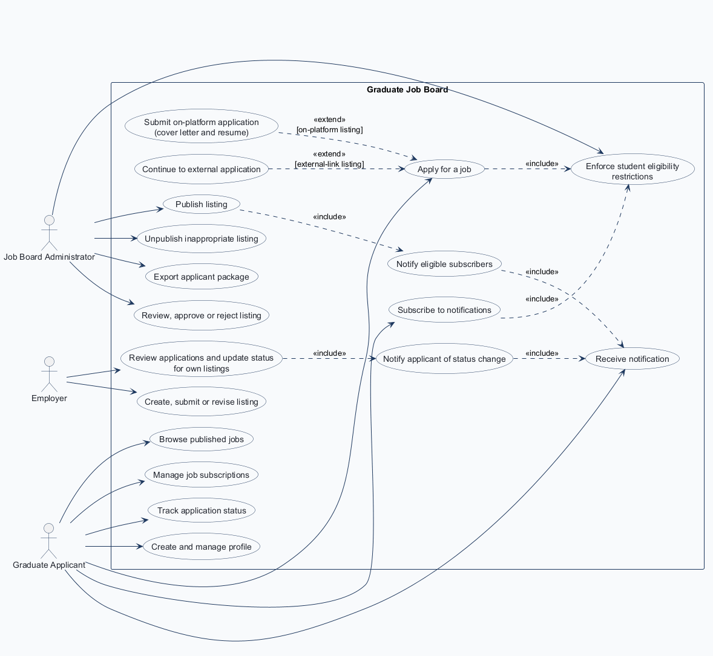
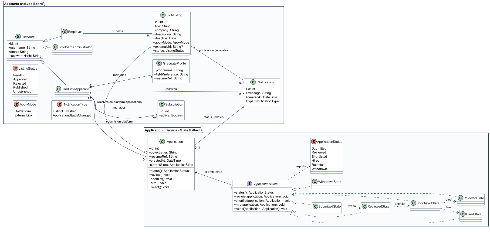

# 1. Cover Page

**The University of the West Indies**  
**St. Augustine Campus**  
**Department of Computing and Information Technology**

**COMP3613 – Software Engineering**

**Graduate Job Board System**

**Sprint 1 – Requirements & Design**

**Group Name:** Digital Dream Team  
**Submission Date:** 17 November 2026

<!-- PDF_COVER_END -->

## 2. Group Members

| Member | Student ID | GitHub username |
| --- | --- | --- |
| Ayesha Sealey | 816043899 | `Ayesha-S04` |
| D'mari Williams | 816043902 | [BossDNW](https://github.com/BossDNW) |
| Gabriella Forrester | 816044301 | `g-abriella` |
| Chernique Homer | 816045448 | [CherniqueHomer](https://github.com/CherniqueHomer) |

Chernique Homer's username was verified with GitHub user search. The other usernames are reproduced from the supplied group details; they have not been independently verified.

## 3. Assigned Project Details

- **Selected scenario:** Scenario 1 – Job Board
- **Starter repository:** `comp3613-job-board`
- **Project name:** Graduate Job Board System
- **Mandatory special feature:** Application Lifecycle and Status Transitions
- **Selected design pattern:** State Design Pattern

The Graduate Job Board System is intended to connect eligible DCIT students with employment opportunities through a centralized platform. Employers submit listings and manage applications, administrators moderate and publish listings, and graduate applicants discover jobs, apply, and track progress. The proposed system aims to improve recruitment communication, transparency, and efficiency.

## 4. Project Links

- **Group GitHub repository (`origin`):** [https://github.com/BossDNW/comp3613-job-board](https://github.com/BossDNW/comp3613-job-board)
- **Trello board invitation:** [Digital Dream Team COMP3613 board invite](https://trello.com/invite/b/6afa8cfe1b9a8a8ac800a57b/ATTI5b9d5af87a06c5e01303e08db5e3876f773B45C7/digitaldreamteam-comp3613-project)
- **Individual Trello card links:** Not available in the repository; placeholders are used in the Sprint 1 planning and review tables.

## 5. Requirements

The priorities and acceptance criteria below are proposed interpretations of the stakeholder expectations. They do not claim that the requirements have been implemented or verified.

### 5.1 Functional Requirements

| ID | Requirement | Priority | Acceptance Criteria | Interview Source |
| --- | --- | --- | --- | --- |
| **FR01** | **Role-Based Access and Eligibility:** The system shall support administrator, employer, and graduate roles and restrict applications and subscriptions to eligible DCIT students. | Must Have | Users can perform only role-permitted actions; only eligible DCIT graduates can apply or subscribe. | Administrator, pp. 2, 16 |
| **FR02** | **Job Listing Management:** Employers shall be able to submit listings, while administrators shall be able to review, approve, reject, and unpublish listings. | Must Have | Employers can submit listings; administrators can moderate them; only approved, published, unexpired listings are available to graduates. | Administrator, pp. 1–4; Employer, pp. 5–6 |
| **FR03** | **Job Applications:** Graduates shall be able to manage profiles, browse job listings, and submit applications with supporting documents. | Must Have | Eligible graduates can manage profiles, view available listings, and submit applications without creating duplicates. | Graduate, pp. 11–12; Administrator, p. 15 |
| **FR04** | **Notifications:** The system shall notify eligible subscribers about relevant published listings and inform applicants of application status changes. | Must Have | Publication of a relevant listing notifies eligible subscribers; a successful application status change notifies the affected applicant. | Administrator, p. 4; Employer, p. 9; Graduate, pp. 11–13 |
| **FR05** | **Application Lifecycle — Mandatory Special Feature:** The system shall manage application statuses through controlled transitions and allow graduates to track application progress. | Must Have | Valid, authorized transitions succeed; invalid or unauthorized transitions are rejected without changing the current status. | Administrator, pp. 1–3, 15–16; Employer, p. 9; Graduate, p. 11 |

### 5.2 Nonfunctional Requirements

| ID | Category | Requirement | Priority | Acceptance Criteria | Interview Source |
| --- | --- | --- | --- | --- | --- |
| **NFR01** | Security | The system shall protect sensitive personal information and prevent unauthorized access. | Must Have | Unauthorized access is denied; sensitive information is securely stored and transmitted. | Administrator, pp. 4–5; Graduate, p. 14 |
| **NFR02** | Performance | The system shall respond to user requests within a reasonable time. | Must Have | Pages load within a few seconds under agreed normal operating conditions. | Administrator, p. 5 |
| **NFR03** | Reliability | The system shall support multiple simultaneous users without crashing. | Must Have | Concurrent user operations do not cause unexpected system failures. | Administrator, p. 5 |
| **NFR04** | Usability | The system shall provide a simple and intuitive interface. | Must Have | Users can navigate the system and complete primary tasks without unnecessary difficulty. | Administrator, p. 5; Employer, p. 10; Graduate, p. 14 |
| **NFR05** | Responsiveness | The system should be accessible on mobile and desktop devices. | Should Have | Core functionality remains usable on mobile and desktop browsers. | Graduate, p. 19 |

## 6. UML Use Case Diagram

**Editable source:** [use_case_diagram.puml](docs/sprint1/member2/diagrams/use_case_diagram.puml) · [SVG image](docs/sprint1/member2/diagrams/use_case_diagram.svg)

The system boundary contains the Graduate Job Board's behavior. The diagram shows the three primary actors, listing moderation, employer listing and application management, graduate profile and application workflows, eligibility checks, and notifications for both listing publication and application status changes. The on-platform and external-link application paths are conditional.

### Actors

- **Job Board Administrator:** Reviews, approves, rejects, publishes, and unpublishes listings; oversees eligibility restrictions and notifications to eligible graduates.
- **Employer:** Creates and submits listings, reviews applicants, and manages the lifecycle of applications for the employer's own listings.
- **Graduate Applicant:** Manages a personal profile and subscriptions, browses listings, submits applications, and tracks application progress.

Use case notes are kept brief. The lifecycle transitions and withdrawal policy are documented in Section 8.

## 7. UML Class Diagram

**Editable source:** [class_diagram.puml](docs/sprint1/member2/diagrams/class_diagram.puml) · [SVG image](docs/sprint1/member2/diagrams/class_diagram.svg)

The proposed domain model includes account roles, profiles, listings, subscriptions, notifications, and applications. `Application` holds one current `ApplicationState` interface implementation. The concrete state classes represent Submitted, Reviewed, Shortlisted, Hired, Rejected, and Withdrawn. The diagram shows the listing/applicant associations, state implementations, and the legal transitions currently represented by the public acceptance criteria.

### Inherited and Proposed Class Structure

| Inherited starter | Proposed design |
| --- | --- |
| `Application` stores a status string and four parallel integer flags. | `Application` delegates lifecycle behavior to one `ApplicationState`; the current status is reported by that state. |
| `app/services/lifecycle.py` uses a hard-coded action tuple and nested conditionals to mutate status and flags. | Concrete state classes encapsulate the operations permitted from each state and reject unsupported transitions. |
| Applicant status is derived from flags in `my_applications()`, so it may disagree with the stored status. | One canonical state value is persisted and its matching state object is reconstructed when an application is loaded. |
| Role checks allow administrators and non-owning employers to change statuses. | The proposed service layer checks the actor and listing ownership before delegating a legal transition to the state object. |

The class diagram is a **proposed draft**, not an implemented design. The repository does not contain a peer-approved version or confirmation from Gabriella Forrester that this is her agreed design. It follows the existing public acceptance-criteria transition path; the differing interview transition is identified in Section 8.4 and requires group reconciliation before the diagram is treated as final.

## 8. Design Pattern Rationale

### 8.1 Mandatory Special Feature

The mandatory special feature is **Application Lifecycle and Status Transitions**. The system must enforce valid, authorized status changes, prevent skipped stages, provide a consistent current status, and keep final application statuses closed.

### 8.2 Verified Inherited Weaknesses

- **Mixed status representations and hard-coded values:** [`app/models/application.py`](app/models/application.py) stores a free-form `status` string alongside `flag_reviewed`, `flag_shortlisted`, `flag_rejected`, and `flag_hired`. [`app/services/lifecycle.py`](app/services/lifecycle.py) hard-codes action names in `ACTIONS`.
- **Inadequate transition validation and reopening:** `apply_action()` in [`app/services/lifecycle.py`](app/services/lifecycle.py) permits `submitted → shortlisted`, allows `hire` from `submitted` and `rejected`, and permits `reopen` to reset any application to `submitted`. Several branches leave flags inconsistent with the status.
- **Complex, tightly coupled transition logic:** `apply_action()` uses nested conditionals over both status and flags. [`app/services/applications.py`](app/services/applications.py) also maps action names, mutates every flag, persists the row, and builds applicant views.
- **Insufficient authorization:** `transition_application()` in [`app/services/applications.py`](app/services/applications.py) allows `admin` and any `employer` without checking listing ownership. `listing_applicants()` checks the viewer's role but not whether an employer owns the listing. The board routes in [`app/routers/board.py`](app/routers/board.py) accept caller-supplied `actor_id` values instead of deriving the actor from an authenticated identity.
- **Inconsistent status visibility:** `my_applications()` in [`app/services/applications.py`](app/services/applications.py) reports `derived_status_from_flags()` instead of consistently returning the stored status. The two representations can disagree.
- **Missing status-change notifications:** The listing service creates notifications for a separate admin notification action, but `transition_application()` does not notify the applicant after a status change.

These are observations of the inherited code, not claims about the proposed design.

### 8.3 Identified Design Pattern

The **State Design Pattern** lets an object change its behavior according to its current state. In the proposed design, `Application` is the context and delegates transition behavior to an `ApplicationState` implementation. `SubmittedState`, `ReviewedState`, and `ShortlistedState` permit only their defined next steps; `HiredState` and `RejectedState` are terminal. Unsupported operations leave the application unchanged.

This design addresses the verified weaknesses by replacing the status/flag combination with one canonical state, moving state-specific rules out of nested service conditionals, and making the legal transition path explicit. Authorization remains a service responsibility: the service must verify the employer role and listing ownership before asking the current state to transition. A successful transition also triggers the applicant notification required by FR04.

No State Pattern implementation is claimed for Sprint 1. The class diagram and methods are proposed only.

### 8.4 Application Lifecycle Rules and Conflicts

The selected-scenario interview summary supplies this proposed transition table:

| Current status | Permitted next status |
| --- | --- |
| Submitted | Reviewed |
| Reviewed | Shortlisted, Rejected |
| Shortlisted | Hired, Rejected |
| Hired | None — final |
| Rejected | None — final |
| Withdrawn | None — final |

Additional administrator interview statements: only the employer who owns the listing may change its application statuses; administrators cannot; applicants cannot withdraw; employers may mark applications as Withdrawn in certain circumstances; and Hired, Rejected, and Withdrawn are permanent. The interview does **not** establish which current statuses may transition to Withdrawn or define the circumstances.

**Unresolved transition conflict:** [`docs/ACCEPTANCE.md`](docs/ACCEPTANCE.md) specifies `submitted → reviewed → shortlisted → rejected|hired`, which does not include `Reviewed → Rejected`. The interview summary permits `Reviewed → Rejected`. [`ASSIGNMENT.md`](ASSIGNMENT.md) calls for correcting the lifecycle design but does not settle this transition. The existing proposed class diagram follows the acceptance-criteria path; Gabriella's approval of that choice has not been verified. The group must agree on the transition table and update the diagram before implementation.

**Withdrawal policy:** The detailed administrator interview resolves one part of the earlier ambiguity: applicants may not withdraw, and employers may set Withdrawn in some circumstances. The valid incoming states and conditions remain unresolved. Do not implement an incoming Withdrawn transition until the group confirms them. No actor may reopen Hired, Rejected, or Withdrawn.

### 8.5 High-Level Change Outline for Sprint 2

- Agree on the transition table, including `Reviewed → Rejected` and the incoming Withdrawn rules.
- Introduce the State Pattern abstraction and implement concrete states.
- Refactor application lifecycle persistence and services to use one canonical state.
- Enforce listing-owner authorization and reject administrator status changes.
- Address eligibility, listing review, application-mode, and notification gaps.
- Add automated tests for valid, invalid, terminal, and unauthorized transitions.

These are proposed Sprint 2 changes; they have not been implemented as part of Sprint 1.

## 9. Stakeholder Interviews

Interviews were conducted through [swen.uwista.dev](https://swen.uwista.dev) with three virtual personas:

- **Job Board Administrator:** Emphasized listing moderation, student eligibility, automatic notifications, and visibility into application statuses. The administrator stated that applicants cannot withdraw; employers may mark applications as Withdrawn in certain circumstances, but the permitted source states were not specified.
- **Employer:** Emphasized listing submission and approval, applicant review, application status management, and communication with applicants.
- **Graduate Applicant:** Emphasized profile management, job discovery, application submission and tracking, notifications, and ease of use.

The selected-scenario transcript is linked in Appendix A. Its page references are used in the requirements tables. No separate exploratory interview transcript or export was found in the repository; none has been fabricated.

## 10. Sprint 1 Report

### Planning

The assignment instructions provide proposed owners and task titles but no task numbers or individual Trello cards in the repository. The entries below retain the proposed assignments; replace each task-number/link placeholder with verified board information.

| Owner | Task Number & Title |
| --- | --- |
| Ayesha Sealey | **TBD — Conduct Stakeholder Interviews.** Task number/card link unavailable. |
| Ayesha Sealey | **TBD — Compile Interview Transcripts.** Task number/card link unavailable. |
| Ayesha Sealey | **TBD — Document Functional and Nonfunctional Requirements.** Task number/card link unavailable. |
| Ayesha Sealey | **TBD — Document Acceptance Criteria and Interview Traceability.** Task number/card link unavailable. |
| D'mari Williams | **TBD — Set Up GitHub Repository.** Task number/card link unavailable. |
| D'mari Williams | **TBD — Inspect and Run Starter Repository.** Task number/card link unavailable. |
| D'mari Williams | **TBD — Create UML Use Case Diagram.** Task number/card link unavailable. |
| D'mari Williams | **TBD — Document Actors and Use Case Notes.** Task number/card link unavailable. |
| Gabriella Forrester | **TBD — Analyze Inherited Codebase and Identify Defects.** Task number/card link unavailable. |
| Gabriella Forrester | **TBD — Identify Appropriate Design Pattern.** Task number/card link unavailable. |
| Gabriella Forrester | **TBD — Create Proposed UML Class Diagram.** Task number/card link unavailable. |
| Gabriella Forrester | **TBD — Document Pattern Rationale and Sprint 2 Changes.** Task number/card link unavailable. |
| Chernique Homer | **TBD — Set Up and Manage Trello Board.** Task number/card link unavailable. |
| Chernique Homer | **TBD — Compile Sprint 1 Report.** Task number/card link unavailable. |
| Chernique Homer | **TBD — Document Sprint 1 Review and Retrospective.** Task number/card link unavailable. |
| Chernique Homer | **TBD — Prepare Sprint 2 Plan.** Task number/card link unavailable. |

### Review

Every task from the planning table is listed below. The supplied instructions require peer verification by another group member before a task is marked Completed. No such verification is evidenced in the repository; therefore, statuses remain **Incomplete** pending the specified check, even where an artifact or team-reported activity exists.

| Owner | Task Number & Title | Status | Comments |
| --- | --- | --- | --- |
| Ayesha Sealey | **TBD — Conduct Stakeholder Interviews** | Incomplete | Interviews are reported complete and the selected-scenario transcript is present; another member's verification is not recorded. |
| Ayesha Sealey | **TBD — Compile Interview Transcripts** | Incomplete | The transcript DOCX is present; completeness and accuracy require peer verification. |
| Ayesha Sealey | **TBD — Document Functional and Nonfunctional Requirements** | Incomplete | Draft requirements are included in this report; peer review and approval remain outstanding. |
| Ayesha Sealey | **TBD — Document Acceptance Criteria and Interview Traceability** | Incomplete | Draft acceptance criteria and source citations are included; verify against the transcript and assignment template. |
| D'mari Williams | **TBD — Set Up GitHub Repository** | Incomplete | The `origin` remote resolves to the group repository; group invitations are reported but not independently evidenced. |
| D'mari Williams | **TBD — Inspect and Run Starter Repository** | Incomplete | Starter source was inspected; local launch is reported, but independent reproduction is not recorded here. |
| D'mari Williams | **TBD — Create UML Use Case Diagram** | Incomplete | Editable source and rendered images exist; another group member's review is outstanding. |
| D'mari Williams | **TBD — Document Actors and Use Case Notes** | Incomplete | Draft actor descriptions and notes exist in the member deliverable and this report; peer review is outstanding. |
| Gabriella Forrester | **TBD — Analyze Inherited Codebase and Identify Defects** | Incomplete | Verified source observations are documented in Section 8.2; peer review is not recorded. |
| Gabriella Forrester | **TBD — Identify Appropriate Design Pattern** | Incomplete | A State Pattern rationale is drafted; confirmation from Gabriella and the group is outstanding. |
| Gabriella Forrester | **TBD — Create Proposed UML Class Diagram** | Incomplete | Editable source and rendered images exist; Gabriella's agreed design and peer approval are unverified. |
| Gabriella Forrester | **TBD — Document Pattern Rationale and Sprint 2 Changes** | Incomplete | Draft rationale and change outline appear in Section 8; peer review is outstanding. |
| Chernique Homer | **TBD — Set Up and Manage Trello Board** | Incomplete | An invitation link was supplied; the board's tasks and card links were not available for verification. |
| Chernique Homer | **TBD — Compile Sprint 1 Report** | Incomplete | This report and PDF are drafts; another member must review them before completion. |
| Chernique Homer | **TBD — Document Sprint 1 Review and Retrospective** | Incomplete | A draft review and retrospective are included; validate task statuses and review it with the group. |
| Chernique Homer | **TBD — Prepare Sprint 2 Plan** | Incomplete | Proposed tasks and owners are listed below; assignment requires group agreement. |

### Retrospective

**Draft for group review:** During Sprint 1, the team focused on requirements gathering, stakeholder analysis, repository setup, and the proposed system design. The stakeholder interviews helped identify the main requirements of the Job Board System, particularly the need for improved visibility into application statuses.

Some challenges were encountered during requirements gathering, including unclear or conflicting stakeholder responses regarding application lifecycle rules. These highlighted the importance of distinguishing confirmed requirements from assumptions.

The starter application was reported as successfully configured and launched locally, establishing a foundation for the upcoming implementation sprint. This activity remains subject to independent verification in the review table.

For Sprint 2, the team aims to improve coordination, resolve outstanding design decisions, maintain clear task ownership, and focus on implementing and testing the State Design Pattern.

### Planning for Sprint 2

The assignees below are proposals based on the supplied role allocation; **all require group agreement**. No Sprint 2 task numbers or card links were available.

| Proposed assignee | Proposed task |
| --- | --- |
| Gabriella Forrester | Agree and document the lifecycle transition contract, including `Reviewed → Rejected` and the Withdrawn entry conditions. |
| Gabriella Forrester | Define the `ApplicationState` interface and make `Application` delegate lifecycle operations to its current state. |
| Gabriella Forrester | Implement and test the Submitted, Reviewed, Shortlisted, Hired, and Rejected state behaviors. |
| D'mari Williams | Refactor application persistence and services to remove parallel status flags and restore the correct state from one canonical status. |
| Ayesha Sealey | Enforce listing-owner-only status changes and deny administrator or non-owner employer changes. |
| Ayesha Sealey | Enforce programme eligibility for applications and subscriptions. |
| Chernique Homer | Implement pending listing review, rejection/revision, publication, unpublishing, and applicant visibility rules. |
| Chernique Homer | Trigger eligible-subscriber notifications on publication and applicant notifications after successful status changes. |
| D'mari Williams | Add automated tests for legal, invalid, skipped, final-state, and unauthorized transitions. |
| Chernique Homer | Integrate the Sprint 2 changes and update the design and requirements documentation after review. |

## Appendix A — Stakeholder Interview Transcripts

The complete selected-scenario interview transcript for the administrator, employer, and graduate applicant is available in [COMP3613ProjectInterview.docx](docs/sprint1/appendix/COMP3613ProjectInterview.docx) (reported as 19 pages). The full transcript text is included in the appendix of `REPORT.pdf`. No separate exploratory interview transcript/export was found in the repository; add it here and to the PDF if the group locates one.
