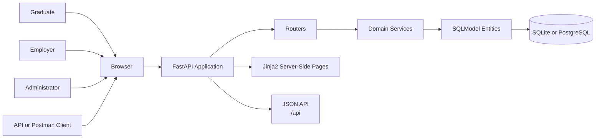
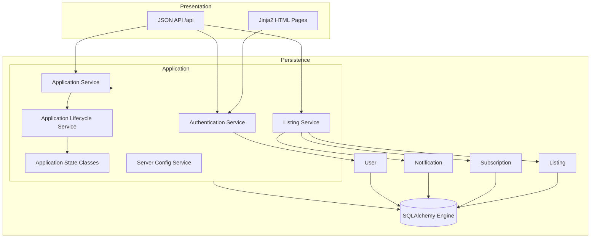
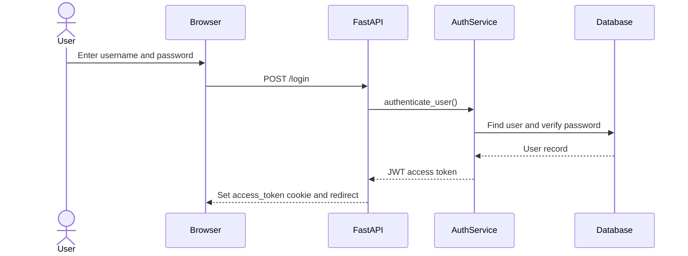
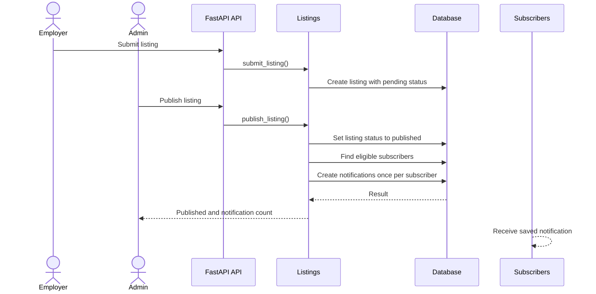
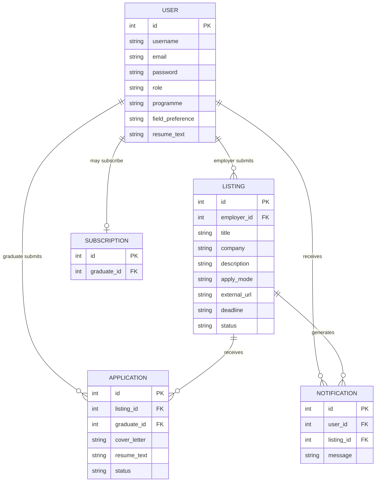
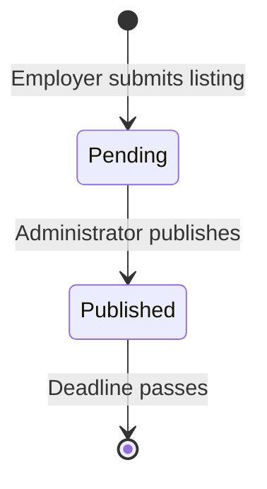
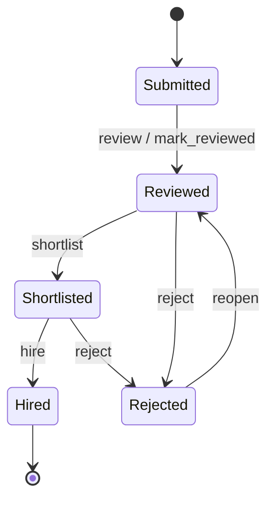

# Job Board Systems Design

## 1. Purpose and scope

This document describes the implemented architecture of the COMP 3613 Job Board application. The system allows:

- Graduates to browse published jobs, subscribe for eligible-job notifications, and submit applications.
- Employers to submit listings and manage applicants for listings they own.
- Administrators to review listings, publish jobs, resend notifications, and export applicant data.

The design is based on the current source code and acceptance criteria in `docs/Deliverables/Requirements/ACCEPTANCE.md`.

## 2. System overview



The application has two presentation paths:

- Server-side rendered pages, implemented with Jinja2 and HTML templates.
- A JSON REST API, mounted below `/api`, documented by OpenAPI at `/docs` in development.

Both presentation paths use the same domain services and database.

## 3. Architectural style

The application uses a layered monolithic architecture:

```text
Browser / API client
        |
        v
Routers and dependencies
        |
        v
Services
        |
        v
Repositories / SQLModel session access
        |
        v
SQLite or PostgreSQL
```

### Key layers

| Layer | Responsibility | Current examples |
|---|---|---|
| Presentation | HTML rendering, route handling, request validation | `app/routers`, `app/templates` |
| Authentication dependencies | Resolve JWT identity and enforce role access | `app/dependencies/auth.py` |
| Services | Business rules and workflows | `app/services/listings.py`, `app/services/applications.py`, `app/services/lifecycle.py` |
| Repositories | User persistence operations | `app/repositories/user.py` |
| Models | Database entities and validation | `app/models` |
| Database | Persistence and transactions | `app/database.py` |

## 4. Components



### Main components

#### FastAPI application

`app/main.py` creates the application, registers middleware, includes HTML and API routers, mounts static files, and provides `/health`.

#### HTML presentation

Jinja2 templates provide:

- Landing page
- Login and registration
- Graduate dashboard and jobs page
- Administrator dashboard
- Server configuration panel

#### JSON API

`app/routers/board.py` exposes job-board operations under `/api`.

#### Domain services

- `listings.py` implements listing submission, publication, eligibility, browsing, subscriptions, and notifications.
- `applications.py` implements application creation, applicant retrieval, export, ownership checks, and transitions.
- `lifecycle.py` converts application actions into State-pattern transitions.
- `application_states.py` contains the legal application states and transitions.
- `auth_service.py` authenticates and registers users.

## 5. Request flow

### Browser login flow



### Listing publication flow



## 6. Data model



There are no ORM relationship objects in the current entity classes. Associations are represented by foreign-key integer fields and are joined by application logic.

## 7. Listing lifecycle



Rules:

- New listings start as `pending`.
- Pending listings are not returned to graduates.
- Published listings are visible only while their deadline is on or after the current date.
- Only administrators may publish listings.
- Publishing automatically creates notifications for eligible subscribers.
- External listings send applicants away from the platform and do not create applications.

## 8. Application lifecycle and State pattern

The application lifecycle is implemented using the State pattern in `app/services/application_states.py`.



### State classes

| State | Legal outgoing actions |
|---|---|
| `SubmittedState` | `review`, `mark_reviewed` |
| `ReviewedState` | `shortlist`, `reject` |
| `ShortlistedState` | `hire`, `reject` |
| `RejectedState` | `reopen` |
| `HiredState` | None |

`ApplicationState.transition()` dispatches an action to a state-specific method. Unsupported actions raise `IllegalTransition`. Unknown actions raise `ValueError`.

The status stored in `Application.status` is the single source of truth. `lifecycle.py` applies the next state and updates the database record.

## 9. API design

All board API routes are prefixed with `/api`.

| Method | Route | Access | Purpose |
|---|---|---|---|
| POST | `/api/auth/login` | Public | Authenticate and set JWT cookie |
| POST | `/api/graduates/subscribe` | Authenticated graduate | Subscribe for notifications |
| GET | `/api/jobs` | Public | List published, unexpired jobs |
| GET | `/api/admin/listings/pending` | Administrator | List pending listings |
| POST | `/api/employer/listings` | Authenticated user | Submit a listing |
| POST | `/api/admin/listings/{listing_id}/publish` | Administrator | Publish a listing |
| POST | `/api/admin/listings/{listing_id}/notify` | Administrator | Resend notifications |
| POST | `/api/graduates/applications` | Graduate | Submit an application |
| GET | `/api/graduates/applications` | Graduate | View own applications |
| GET | `/api/listings/{listing_id}/applicants` | Employer/admin | View listing applicants |
| GET | `/api/admin/listings/{listing_id}/export` | Administrator | Export applicant package |
| POST | `/api/applications/{application_id}/transition` | Listing employer | Advance or reopen an application |

Expected HTTP error mapping includes:

- `400` invalid action or invalid request
- `403` forbidden role or ownership mismatch
- `404` missing resource
- `409` illegal state transition

## 10. Security and authorization

### Authentication

- JWT access tokens are stored in an `access_token` cookie.
- The configured algorithm is HS256.
- Cookie attributes, including HTTPS behavior, are managed by `access_token_cookie_kwargs()`.
- Passwords are hashed by the authentication service.

### Role authorization

| Operation | Authorized role |
|---|---|
| Subscribe | Eligible DCIT graduate |
| Apply on-platform | Eligible DCIT graduate |
| Submit listing | Employer |
| Publish listing | Administrator |
| Resend notifications | Administrator |
| Export applications | Administrator |
| Advance application | Owning employer only |

The system enforces two separate ownership boundaries:

1. A listing employer may manage only applications associated with their own listings.
2. Administrators may export applicant data but may not advance application lifecycle in the normal workflow.

### Data and privacy

- Login responses should not expose password material.
- Applicant listings require role and listing-ownership checks.
- External-listing applications are not stored.
- Export operations are restricted to administrators.

## 11. Database design

The application uses SQLModel over SQLAlchemy.

### Development database

The example environment uses SQLite through:

```text
sqlite:///database.db
```

### Production database

Render configuration uses PostgreSQL 16 and the `DATABASE_URI` environment variable. The database module normalizes legacy `postgres://` URLs to SQLAlchemy-compatible PostgreSQL URLs.

### Startup and recovery

At startup, the application:

1. Runs database seeding when the application lifespan begins.
2. Creates database tables if the configured database is ready.
3. Retries transient database-startup failures.
4. Detects missing schemas when a request arrives and attempts recovery.

## 12. Deployment architecture

```mermaid
flowchart LR
    User[User or API Client] --> Render[Render Web Service]
    Render --> App[FastAPI Application]
    App --> PG[(PostgreSQL)]
    Health[/health] --> Render
```

The repository provides:

- `Dockerfile` for a containerized Python 3.14 deployment.
- `render.yaml` for a Render web service and PostgreSQL database.
- `manage.py` commands for initialization and execution.
- `/health` as the health endpoint.

## 13. Configuration

The application reads configuration through Pydantic Settings.

| Setting | Purpose |
|---|---|
| `DATABASE_URI` | SQLite or PostgreSQL connection |
| `SECRET_KEY` | Session and application secret |
| `ENV` | Development or production behavior |
| `CONFIG_PASSWORD` | Optional server configuration-panel access |
| `JWT_ALGORITHM` | JWT signing algorithm |
| `JWT_ACCESS_TOKEN_EXPIRES` | Token lifetime setting |
| `APP_HOST` / `APP_PORT` | Bind address and port |

OpenAPI and ReDoc are enabled in development and disabled in production.

## 14. Main workflows

### Graduate workflow

1. Register or log in.
2. Optionally subscribe for notifications.
3. Browse `/jobs`.
4. Apply to an eligible on-platform listing.
5. View applications and their current status.

### Employer workflow

1. Register or log in as an employer.
2. Submit a listing.
3. Wait for administrator publication.
4. View applicants for owned listings.
5. Advance application states only through legal transitions.

### Administrator workflow

1. Log in as an administrator.
2. Review pending listings.
3. Publish approved listings.
4. Send or resend subscriber notifications.
5. Export applicant packages.

## 15. Testing strategy

The test suite is organized by behavior:

- `test_unit.py` - focused unit behavior
- `test_integration.py` - service and database integration
- `test_scenario.py` - public scenario and acceptance behavior
- `test_regression.py` - defect prevention
- `test_integration.py` - API and persistence integration

Recommended system-design test coverage includes:

- Listing publication visibility
- Listing deadline expiry
- Eligible versus ineligible graduate access
- External versus collected application behavior
- Every legal application transition
- Illegal application transition errors
- Employer ownership enforcement
- Subscriber de-duplication
- Password and login safety
- Administrator export behavior

## 16. Known design boundaries

- Listing and application foreign keys are stored as integer fields rather than explicit ORM relationships.
- Notification delivery is represented by database records; no external email or push provider is part of the current design.
- Subscriptions are one-per-graduate.
- Notifications are deduplicated using `listing_id` and `user_id`.
- The application is deployed as a monolith, not separate microservices.
- The State pattern controls application status, but listing status is still a simple string field.
- Job searches and pagination are not currently implemented.
