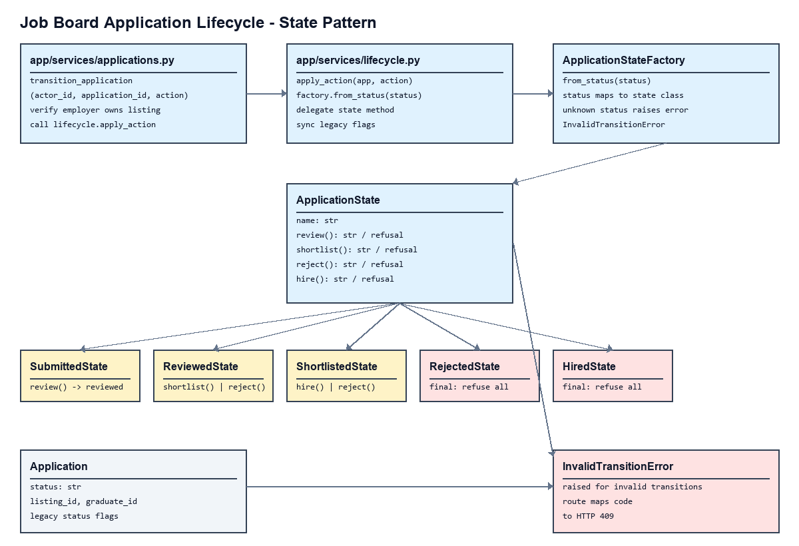

# Sprint 2 Pattern Evidence

## 1. Special Feature

The special feature is the application lifecycle. Applications use Submitted, Reviewed,
Shortlisted, Rejected and Hired statuses. Legal moves are Submitted to Reviewed, Reviewed
to Shortlisted or Rejected, and Shortlisted to Hired or Rejected. Rejected and Hired are
final statuses. Skipping stages, moving backwards and changing a final status are refused.
Only the employer who owns the listing may change an application status.

## 2. Inherited Defect

Git history confirms that the original `app/services/lifecycle.py` used a status string
and four boolean flags: `flag_reviewed`, `flag_shortlisted`, `flag_rejected` and
`flag_hired`. Its `apply_action` function used mixed status and flag checks in nested
`if` and `elif` blocks. The original code stated that it was
“procedural flag soup” and that the fields were updated through nested conditionals.
This allowed invalid jumps, including Submitted to Hired, terminal states to change,
rejected applications to be hired or shortlisted, and `reopen` to reset status without
clearing terminal flags. It could also return successful no-op responses instead of
refusing some invalid changes.

## 3. Pattern Implemented

The State pattern is implemented in `app/services/application_states.py` and
`app/services/lifecycle.py`.

| Participant | Real code |
|---|---|
| State interface | `ApplicationState` in `app/services/application_states.py` |
| Concrete states | `SubmittedState`, `ReviewedState`, `ShortlistedState`, `RejectedState` and `HiredState` in `app/services/application_states.py` |
| State factory | `ApplicationStateFactory.from_status` in `app/services/application_states.py` |
| Transition error | `InvalidTransitionError` in `app/services/application_states.py` |
| Service logic | `apply_action` in `app/services/lifecycle.py` |
| Ownership and persistence service | `transition_application` in `app/services/applications.py` |

The application model is `Application` in `app/models/application.py`. It retains the
four legacy flags in the existing database schema. No code reads them for lifecycle
decisions. Successful transitions synchronize them with `status`, and tests prove that
each legal result agrees with the canonical status. Removing the flags would require a
later schema migration and is therefore a Sprint 3 cleanup rather than part of this
implementation.

The starter also has no separate application repository class. The code uses SQLModel
`Session` operations directly in `app/services/applications.py`, so route to service to
model is the repository boundary available in this codebase.

## 4. How It Works

The status route `transition` in `app/routers/board.py` receives the application identifier,
actor identifier and action. It calls `applications.transition_application`. That function
checks that the actor is an employer, loads the application and listing, and verifies that
`listing.employer_id` equals the actor. For an owned application, it calls
`lifecycle.apply_action`.

For a legal Submitted to Reviewed move, `apply_action` uses
`ApplicationStateFactory.from_status("submitted")`, obtains `SubmittedState`, and maps
`mark_reviewed` to `SubmittedState.review()`. The state returns `ReviewedState.name`,
which is `"reviewed"`. `apply_action` updates a copy and synchronizes the legacy flags.

For an illegal move, such as shortlisting a Submitted application, `SubmittedState` does
not implement a transition for `shortlist`, so it inherits `ApplicationState.shortlist`.
That method calls `_refuse` and raises `InvalidTransitionError`. `apply_action` converts
this exception to `{"ok": False, "code": "invalid_transition", "error": ...}`. The status
route maps the `"invalid_transition"` code to HTTP 409 in `_STATUS_BY_CODE`.

The `reopen` action is also refused by `apply_action`, which raises
`InvalidTransitionError` for every state instead of resetting an application to Submitted.
This prevents a Rejected or Hired application from reopening.

The running API demonstrated both outcomes. A `mark_reviewed` request from the listing
owner returned HTTP 200 with `status: "reviewed"`. A subsequent `hire` request from the
reviewed state returned HTTP 409 with `detail: "cannot hire an application that is
reviewed"`.

## 5. Key Files and Pull Requests

| File | Pattern evidence |
|---|---|
| [app/services/application_states.py](../app/services/application_states.py) | State interface, concrete states, factory and transition exception |
| [app/services/lifecycle.py](../app/services/lifecycle.py) | State delegation and application status updates |
| [app/services/applications.py](../app/services/applications.py) | Listing-owner authorization and persistence |
| [app/models/application.py](../app/models/application.py) | Status and compatibility fields |
| [app/routers/board.py](../app/routers/board.py) | Status route and HTTP 409 mapping |
| [tests/test_lifecycle_states.py](../tests/test_lifecycle_states.py) | State and lifecycle unit tests |
| [tests/test_lifecycle.py](../tests/test_lifecycle.py) | HTTP integration and ownership tests |

Pull requests:

- [State pattern implementation PR](https://github.com/varunegit/comp3613-job-board-ByteBuilders/pull/10)
- [Lifecycle unit test PR](https://github.com/varunegit/comp3613-job-board-ByteBuilders/pull/12)
- [Sprint 2 acceptance gap PR](https://github.com/varunegit/comp3613-job-board-ByteBuilders/pull/13)

## 6. Tests

`tests/test_lifecycle_states.py` covers factory state names, unknown statuses, every legal
and illegal transition, skipped stages, backward moves, Rejected and Hired final states,
`reopen`, unknown actions, full lifecycle paths, and status flag consistency.
The `test_reopen_is_always_refused` case checks every status and
`test_lifecycle.py::test_reopen_is_gone` confirms that reopening after rejection returns
HTTP 409.

`tests/test_lifecycle.py` covers the HTTP transition endpoint, initial Submitted status,
owner lifecycle changes, 409 responses for skipped and final-state changes, listing-owner
authorization, status and flag consistency, unknown applications and applicant viewing.

The command `py -m pytest tests -q` produced 86 passed and 1 warning.

The whole application coverage command was
`py -m pytest tests --cov=app --cov-report=term-missing`. It produced 86 passed,
3 warnings and 29 percent coverage across the whole application. The lifecycle modules
were `application_states.py` at 100 percent, `application.py` at 100 percent,
`lifecycle.py` at 97 percent, `applications.py` at 84 percent and `board.py` at 83 percent.

The critical lifecycle paths are covered. Tests verify every legal transition, illegal
and skipped transitions, backward moves, terminal states, `reopen`, listing-owner
authorization, administrator and other-employer refusal, HTTP 409 responses, HTTP 404
for unknown applications and status flag consistency. The lower whole-application
percentage reflects large untested areas outside the lifecycle feature.

## 7. Match with the Class Diagram

The PNG `docs/Diagrams/class_diagram_jobboard.drawio.png` was a Sprint 1 diagram and
did not represent the implemented functions exactly. It showed an `ApplicationService`
class instead of the real module-level `transition_application` function and omitted the
HTTP transition route.

The PNG [class_diagram_jobboard_state_pattern.png](Diagrams/class_diagram_jobboard_state_pattern.png)
shows the implemented structure. It shows `transition_application` in
`app/services/applications.py`, `apply_action` in `app/services/lifecycle.py`,
`ApplicationStateFactory`, `ApplicationState`, all five concrete states,
`InvalidTransitionError`, `Application.status` and the legacy fields. It also shows the
HTTP `"invalid_transition"` mapping to status 409.

## Known Gaps

- The four legacy boolean flags remain in the database schema. They are kept in step with
  status, no code reads them for lifecycle decisions, and removing them requires a schema
  migration planned for Sprint 3.
- `board.py` is covered at 83 percent and `applications.py` is covered at 84 percent.
- There is no separate repository class because the starter has none.

