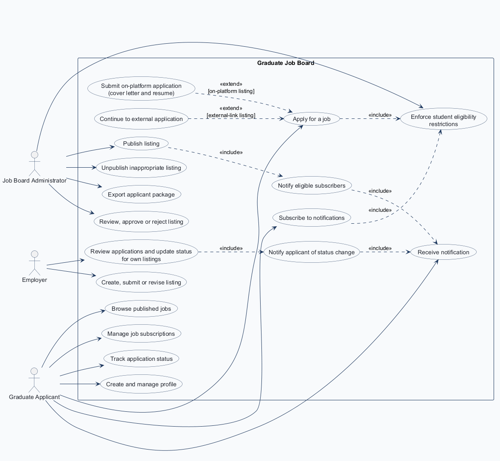
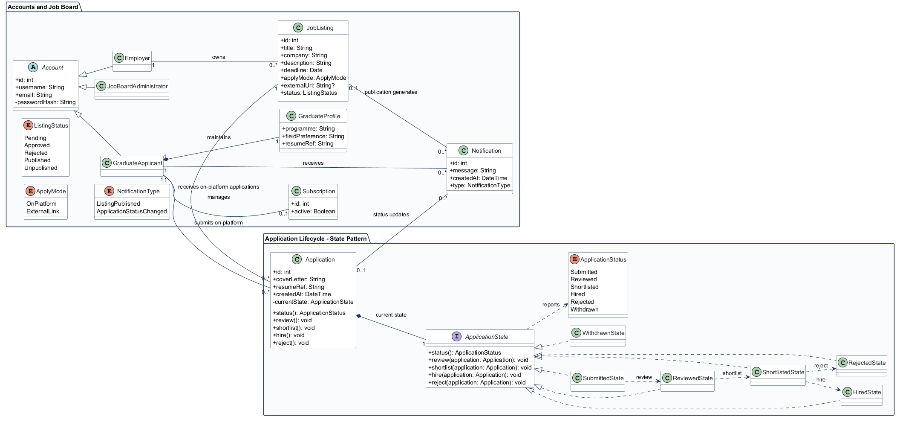

# Sprint 1 — Requirements and Design

## Purpose and sources

This deliverable proposes the Graduate Job Board's use cases from the stakeholder requirements and the inherited project. The review covered the project [README](../../../README.md), [assignment brief](../../../ASSIGNMENT.md), [acceptance criteria](../../ACCEPTANCE.md), domain models, routers, services, tests, and server-rendered templates. The diagram describes the target requirements; it is not a claim that the inherited application already implements them.

## UML diagrams

### Use case diagram

[Open the scalable SVG version](diagrams/use_case_diagram.svg) · [Edit the PlantUML source](diagrams/use_case_diagram.puml)

The system boundary encloses Graduate Job Board behavior; the three external actors represent its administrative, employer, and graduate roles. Application-mode extensions are conditional: on-platform listings collect supporting documents, while external-link listings send applicants to the employer's destination. Publishing includes notifying eligible subscribers; a successful application status change notifies its applicant. Eligibility checks are included for applications and subscriptions.

### Class diagram

[Open the scalable SVG version](diagrams/class_diagram.svg) · [Edit the PlantUML source](diagrams/class_diagram.puml)

The class diagram focuses on account roles, job-board domain entities, and application lifecycle states. An employer owns listings; each on-platform application belongs to one graduate and one listing; subscriptions and notifications belong to graduates. The service layer is described separately below to keep the domain and lifecycle view readable.

#### Application lifecycle State pattern

`Application` is the State-pattern context: it keeps one `ApplicationState` interface implementation and delegates status queries and decisions to it. `SubmittedState` permits review, `ReviewedState` permits shortlisting, and `ShortlistedState` permits hiring or rejection. `HiredState` and `RejectedState` are terminal, so no transition reopens a final application. Unsupported actions are rejected without changing state.

The service layer authorizes the employer and verifies ownership of the listing before requesting a transition; the state objects enforce the legal sequence. Persist one canonical status value and reconstruct its corresponding state when loading an application—do not keep parallel status flags.

`WithdrawnState` appears because **Withdrawn** is a required status. The administrator interview says applicants cannot withdraw and an employer may set this status in some circumstances; the exact allowed source states and conditions remain for stakeholder confirmation. No transition into `WithdrawnState` is shown until those rules are agreed.

#### Service and policy responsibilities

In the layered implementation, the application service checks programme eligibility before applying or subscribing, verifies that a status-change request comes from the employer that owns the listing, and triggers applicant notifications after successful status changes. The listing service controls submission, review, approval, rejection, publication, and unpublishing; successful publication triggers notification delivery to eligible subscribers. Repository classes are intentionally omitted from this domain-focused diagram.

## Actors

| Actor | Description |
| --- | --- |
| **Job Board Administrator** | Reviews employer-submitted listings, approves or rejects them, publishes or unpublishes listings, enforces graduate eligibility restrictions, and may export applicant packages. The administrator does not change application statuses. |
| **Employer** | Creates and submits listings, revises rejected listings, and reviews applications for listings the employer owns. The listing owner alone may advance an application through permitted employer decisions. |
| **Graduate Applicant** | Maintains a graduate profile, browses published jobs, subscribes to notifications, applies to jobs, and tracks application status. Programme eligibility is checked for applications and subscriptions. |

## Main use cases

### UC-1 — Sign in

- **Actor(s):** Administrator, Employer, Graduate Applicant.
- **Preconditions:** The actor has an account.
- **Basic flow:** The actor provides credentials; the system verifies them and grants access for the account's role.
- **Alternative flows:** Invalid credentials are rejected. An unauthenticated actor cannot perform role-restricted actions.

### UC-2 — Create and manage a graduate profile

- **Actor(s):** Graduate Applicant.
- **Preconditions:** The applicant is signed in as a graduate.
- **Basic flow:** The applicant creates or updates profile details, programme information, preferences, and supporting resume information.
- **Alternative flows:** Invalid or incomplete information is returned for correction. The system must not expose another graduate's profile.

### UC-3 — Browse published jobs

- **Actor(s):** Graduate Applicant.
- **Preconditions:** None for browsing.
- **Basic flow:** The applicant searches or browses listings that are published and have not passed their deadline, then opens a listing's details.
- **Alternative flows:** If no matching listings are available, the system shows an empty result. Pending, rejected, unpublished, and expired listings are not available to applicants.

### UC-4 — Manage job subscriptions and receive notifications

- **Actor(s):** Graduate Applicant manages subscriptions and receives notifications; Job Board Administrator publishes listings to initiate notification delivery.
- **Preconditions:** The applicant is signed in. Adding a subscription requires an eligible programme.
- **Basic flow:** The applicant adds or removes a job-notification subscription. When a listing is published, the system notifies eligible subscribers; when an employer changes an application status, the system notifies that applicant.
- **Alternative flows:** An ineligible graduate cannot subscribe. If there are no eligible subscribers, publication still succeeds without recipients to notify.

### UC-5 — Create, submit, and revise a listing

- **Actor(s):** Employer.
- **Preconditions:** The employer is signed in.
- **Basic flow:** The employer enters listing details, deadline, and application mode, then submits the listing for administrator review. The listing remains unavailable to applicants until published.
- **Alternative flows:** The administrator rejects the listing with a reason; the employer revises and resubmits it. Missing or invalid details prevent submission.

### UC-6 — Review, approve, reject, publish, or unpublish a listing

- **Actor(s):** Job Board Administrator.
- **Preconditions:** The administrator is signed in; the listing is available for review or is currently published.
- **Basic flow:** The administrator reviews a submitted listing, approves or rejects it, and publishes approved listings. Publication triggers eligible-subscriber notifications. The administrator can unpublish an inappropriate listing.
- **Alternative flows:** Rejection returns the listing for employer revision and keeps it hidden. Unpublishing removes a listing from applicant browsing; it does not change application statuses.

### UC-7 — Apply for a job

- **Actor(s):** Graduate Applicant.
- **Preconditions:** The listing is published and open, and the applicant meets programme eligibility requirements.
- **Basic flow:** The applicant selects an application mode. For an on-platform listing, the applicant submits a cover letter and resume; the system records the application with status **Submitted**. For an external-link listing, the system directs the applicant to the employer's application destination and does not record an in-platform application.
- **Alternative flows:** An ineligible applicant, expired listing, or unavailable listing is refused. Missing required on-platform materials are returned for correction.

### UC-8 — Review applications and update application status

- **Actor(s):** Employer who owns the listing.
- **Preconditions:** The employer is signed in and owns the listing.
- **Basic flow:** The employer views applications for that listing and advances an application only along a valid transition: **Submitted → Reviewed → Shortlisted → Hired** or **Submitted → Reviewed → Shortlisted → Rejected**.
- **Alternative flows:** A non-owner employer or administrator is denied status-change access. An invalid or skipped transition is rejected without changing the current status. **Hired** and **Rejected** are final; they cannot be reopened.

### UC-9 — Track application status

- **Actor(s):** Graduate Applicant.
- **Preconditions:** The applicant is signed in and has an application.
- **Basic flow:** The applicant views their own applications and one consistent current status for each.
- **Alternative flows:** Applications belonging to other graduates are not disclosed. For an external-link application, the board does not represent an uncollected employer-side application as a board record.

### UC-10 — Export applicant package

- **Actor(s):** Job Board Administrator.
- **Preconditions:** The administrator is signed in and the requested listing exists.
- **Basic flow:** The administrator exports the applicant package for careful forwarding or review.
- **Alternative flows:** A non-administrator is denied. An unknown listing returns an error.

### Withdrawal — transition policy unresolved

**Withdrawn** is included in the required status vocabulary and is intended to be final. The administrator interview says applicants may not withdraw, and employers may set the status in certain circumstances; permitted source states and conditions were not established. The implementation and earlier acceptance criteria do not define this status. Confirm the employer's allowed transitions before implementing the use case.

## Application lifecycle and authorization rules

The proposed employer-controlled path follows the public acceptance criteria: **Submitted → Reviewed → Shortlisted → Hired or Rejected**. The interview summary also lists **Reviewed → Rejected**, which conflicts with the acceptance criteria and requires group agreement. Skipped stages and transitions out of final statuses are disallowed. **Withdrawn** is an additional final status; applicants may not withdraw, while the employer may set it only under circumstances that still need definition. Applicants may track their own status; only the employer owning the listing may make the defined employer status changes; administrators may not change application statuses.

The «include» relationships model mandatory eligibility checks for application and subscription, and notification delivery when a listing is published or an application status changes. The «extend» relationships model the mutually conditional on-platform and external application modes.

## Differences from the inherited implementation

| Area | Inherited behavior | Proposed requirement / gap |
| --- | --- | --- |
| Roles and presentation | Seed data includes `admin`, `employer`, and `graduate`; the server-rendered pages are a generic login/home/admin shell, with job-board work mainly exposed through a JSON API. Generic web registration creates a graduate account. | Role-specific graduate/employer accounts and the profile workflows need a defined user-facing path. |
| API authentication | Passwords are hashed and the email-based scenario login omits password fields from its public user response. However, job-board operations accept an `actor_id` in a request body or query string rather than deriving the actor from the authenticated session. | Bind actions to a verified identity and enforce role and ownership permissions server-side. |
| Listing review | Employers can submit listings, but submission immediately marks them `published`. Admin routes list pending listings and publish a listing, but there are no listing-reject, rejected-listing-revision, or unpublish operations. | Submission must remain pending until admin approval/publication; rejection, revision, and unpublishing must be supported. |
| Listing visibility and notifications | Graduate browse returns all listings, including pending and expired entries. Publishing does not notify; a separate admin notification endpoint sends to every subscription without an eligibility check. Application status changes do not create applicant notifications. | Only published, unexpired listings are visible; publication should notify eligible subscribers, and successful status changes should notify the applicant. |
| Eligibility and subscriptions | `ELIGIBLE_PROGRAMMES` contains `DCIT`, but the subscription and application services do not enforce it. Subscription creation exists, but removal and notification viewing/management are absent. | Enforce eligibility for both applying and subscribing, and provide subscription management. |
| Application modes and profile | Listing models support `collect` and `external`, but the application service creates an in-platform application for either mode. A graduate profile editor is not present in the inspected templates/routes. | Collect mode records a cover letter and resume; external mode redirects and must not create an in-platform application. Profile creation and management are required. |
| Application ownership | The applicant listing endpoint allows any employer to read a listing's applicants; transition authorization allows any employer or administrator to change statuses without checking listing ownership. | Restrict application review and status changes to the listing-owning employer; administrators cannot change statuses. |
| Lifecycle | The implementation stores both a status string and boolean flags. Actions include `mark_reviewed`, `shortlist`, `reject`, `hire`, and `reopen`; some actions skip stages, allow terminal-state changes, or leave status and flags inconsistent. The graduate view derives a status from flags instead of consistently using the status field. There is no `withdrawn` status/action. | Use one canonical current status and enforce the approved transition graph, actor authorization, no skipped stages, and no reopening. Withdrawal authority and allowed source states need stakeholder resolution. |
| Existing additional feature | An admin applicant-package export endpoint exists and is included in the diagram because it appears in the inherited acceptance criteria. | Preserve appropriate access controls and careful handling of applicant data. |
| Tests | The scenario tests cover health, seeded login, and that jobs return a list; the unit tests primarily exercise starter authentication behavior. They do not cover the required job ownership, eligibility, listing review, or lifecycle rules. | Add focused acceptance tests for the proposed authorization and transition rules during implementation. |

These are requirements/design findings, not source-code changes. The existing main README and application source remain untouched.
